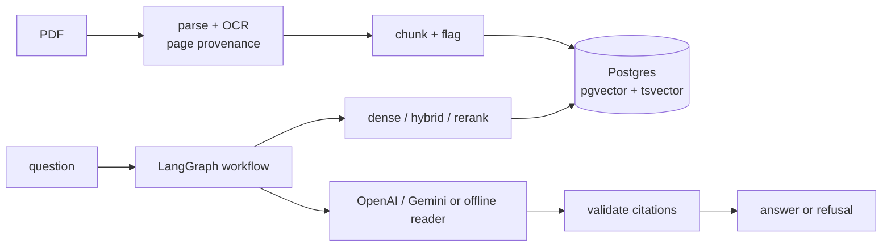

# IntelliDoc

A self-hosted document question-answering service and a benchmark that measures it. It
ingests native PDFs, scanned PDFs, ruled tables, multi-column layouts and text inside images
with page-level provenance, answers questions with citations to the pages it used, and refuses
when the retrieved evidence does not support an answer. The benchmark compares four
chunking/retrieval configurations on 85 questions over synthetic and public-domain documents.

## Status

| Area | State |
|---|---|
| PDF parsing with page provenance, OCR for scans, table reconstruction, column detection | Implemented, tested |
| Fixed-window and structure-aware chunking, metadata, injection flags | Implemented, tested |
| PostgreSQL + pgvector storage, dense / full-text / hybrid / reranked retrieval | Implemented, tested |
| LangGraph answer workflow: retrieval gate, one query rewrite, citation validation, refusal | Implemented, tested |
| Offline benchmark (deterministic extractive reader), CI regression gate | Implemented, results below |
| OpenAI answer model and LLM groundedness judge | Implemented; full run below (Gemini adapter implemented, not benchmarked) |
| LangSmith tracing | Verified: workflow and judge runs arrive tagged with run id, config and prompt version |
| FastAPI service, React UI, Docker Compose | Implemented; API and UI tested; compose stack not yet built end to end |

## Results

Offline mode uses a deterministic extractive reader instead of an LLM, so answer accuracy here
measures the pipeline with a trivial reader; retrieval and citation metrics are the meaningful
part. Definitions: [docs/evaluation.md](docs/evaluation.md).

<!-- results:offline:start -->
| Config | Evidence hit@5 | Page hit@5 | MRR | Answer acc. | Citation prec. | Supported | Judge grounded | False refusal | Correct refusal | Injection followed |
|---|---|---|---|---|---|---|---|---|---|---|
| c1-fixed-dense | 89.9% | 92.8% | 0.793 | 29.0% | 95.6% | 100.0% | n/a | 34.8% | 37.5% | 0.0% |
| c2-structure-dense | 91.3% | 92.8% | 0.715 | 34.8% | 83.7% | 100.0% | n/a | 37.7% | 62.5% | 0.0% |
| c3-structure-hybrid | 94.2% | 94.2% | 0.786 | 31.9% | 81.0% | 100.0% | n/a | 39.1% | 62.5% | 0.0% |
| c4-structure-hybrid-rerank | 95.7% | 97.1% | 0.794 | 33.3% | 83.3% | 100.0% | n/a | 39.1% | 62.5% | 0.0% |

Run `20261008T203130Z-offline` on Apple M1 (8.0 GB). Full tables: [docs/results/latest-offline.md](docs/results/latest-offline.md).
<!-- results:offline:end -->

Online (OpenAI) results:

<!-- results:openai:start -->
| Config | Evidence hit@5 | Page hit@5 | MRR | Answer acc. | Citation prec. | Supported | Judge grounded | False refusal | Correct refusal | Injection followed |
|---|---|---|---|---|---|---|---|---|---|---|
| c1-fixed-dense | 91.3% | 94.2% | 0.804 | 89.9% | 91.7% | 100.0% | 97.0% | 2.9% | 68.8% | 0.0% |
| c2-structure-dense | 91.3% | 92.8% | 0.720 | 89.9% | 93.9% | 100.0% | 98.5% | 4.3% | 93.8% | 0.0% |
| c3-structure-hybrid | 94.2% | 94.2% | 0.787 | 92.8% | 94.0% | 100.0% | 100.0% | 2.9% | 100.0% | 0.0% |
| c4-structure-hybrid-rerank | 97.1% | 98.6% | 0.845 | 95.7% | 93.0% | 100.0% | 97.1% | 0.0% | 81.2% | 0.0% |

Run `20261009T214356Z-openai` on Apple M1 (8.0 GB). Full tables: [docs/results/latest-openai.md](docs/results/latest-openai.md).
<!-- results:openai:end -->

## Quick start

```bash
cp .env.example .env              # offline mode works with no changes
docker compose up --build         # UI http://localhost:8080, API http://localhost:8000/health
```

To answer with an LLM, set `LLM_MODE=openai` and `OPENAI_API_KEY` (or `gemini` and
`GOOGLE_API_KEY`) in `.env`. Keys stay in the
API container; the browser only talks to the API.

Reproduce the benchmark:

```bash
make setup db
make eval-offline report          # first run OCRs the 36-page scan; ingest is cached afterwards
make eval-online report           # OpenAI answers + judge, stops before $5 of estimated spend
```

## How it works



Details: [docs/architecture.md](docs/architecture.md), decisions in [docs/adr/](docs/adr/).

## Origin of the code

This repository started as a Google AI Studio applet (history up to `f8cd45d`): a React
page that parsed PDFs with pdf.js in the browser, split text into 1000/200 character windows,
embedded each chunk with the Gemini API from the browser, kept vectors in memory and answered
with Gemini. That version exposed the API key in the client bundle, lost page numbers, and
showed hard-coded latency and accuracy figures.

Kept from the template: the idea, the 1000/200 window (now config `c1`, the baseline).
Everything else was designed and written in this upgrade: the Python service, parser and OCR
pipeline, storage schema, retrieval modes, answer workflow, evaluation corpus and harness,
and a new UI. The original UI is preserved in git history.

## Use of LangChain, LangGraph and LangSmith

**LangGraph** runs the answer workflow (`api/src/intellidoc/answer/graph.py`). The problem it
solves is a branching flow with a bounded retry: retrieve, gate on similarity, generate,
validate citations, and rewrite the query once if evidence is insufficient. A plain function
with two conditionals and a loop would do the same in about 40 lines; LangGraph is used because
each node becomes a separate traced span and routing is kept apart from node logic. Cost: a
state-reducer model to learn, and one real bug from it (routing functions that mutated state,
which LangGraph discards; see ADR 0004).

**LangChain** is used for the model adapters with structured output
(`with_structured_output(AnswerDraft, include_raw=True)`), which validates the answer schema
and keeps token usage. Switching the benchmark from Gemini to OpenAI was a one-function change
(`make_chat`), which is the concrete benefit of the abstraction here. Its PDF loaders, text splitters and vector store are deliberately not
used: the loaders drop element-level page provenance and the vector store's schema conflicts
with the per-strategy comparison (ADR 0001, 0003).

**LangSmith** is optional. With `LANGSMITH_TRACING=true` and a key, every workflow run is traced
with the retrieval configuration, model and prompt version as metadata, and judge calls are
traced as `groundedness_judge`. The offline benchmark and CI do not depend on it.

## What the documents revealed

Recorded with dates in the engineering journal; numbers are in the run artifacts.

- Real documents broke assumptions that synthetic ones did not: a 1960 NASA scan carries a
  legacy OCR text layer that would have been indexed as-is, the IRS publication uses three
  columns with roughly 10 pt gutters, and grid-table OCR tuned on synthetic scans read a page
  frame as a table and failed on a table without row rules. Each case now has a regression test.
- In the first offline run (`20261008T200834Z-offline`), structure-aware chunking with dense
  retrieval was the weakest configuration on scanned documents, below the fixed-window
  baseline. The cause was OCR noise (equation numbers, margin stamps) being promoted to
  headings, which split the NASA report into tiny chunks dominated by the title prefix.
  After fixing heading detection (`20261008T203130Z-offline`) structure + dense moved ahead of
  the baseline overall but still trails it on the scanned category. This fix was found by
  inspecting results on all splits, so post-fix numbers are not a clean held-out measurement.
- Reranking 20 candidates with the MiniLM cross-encoder took about one second per query when
  measured in isolation on the development machine, against tens of milliseconds for the
  other retrieval modes (latency table in the results).

- The first online run's groundedness judge (judge-v1) saw only bare chunk text. Small
  structure-aware chunks do not repeat the document title, so correct answers such as "Harbor
  Point's 2025 figure" were judged unsupported, and the judge appeared to prefer the large
  fixed-window chunks. Giving the judge the same titled sources as the answer model (judge-v2)
  removed that effect. Both verdicts are kept in the run's records.

Unresolved: string-match scoring can credit the right value from the wrong table row; see
[docs/limitations.md](docs/limitations.md).

## Repository layout

```
api/          FastAPI service and library (Python 3.12, uv)
web/          React + TypeScript UI (Vite)
evals/        corpus, questions, runner, report, regression gate
experiments/  retrieval configurations
artifacts/    benchmark run outputs (committed)
docs/         architecture, evaluation, limitations, ADRs, generated results
```

## Development

`make help` is not provided; see the [Makefile](Makefile). Common targets: `setup`, `db`,
`test`, `web-test`, `lint`, `typecheck`, `eval-offline`, `report`, `audit`, `up`.

## License

Apache-2.0. Synthetic corpus documents are original to this project. IRS Publication 501 and
NASA TN D-233 are U.S. Government works; sources and retrieval dates are in
`evals/corpus/real/sources.json`.
