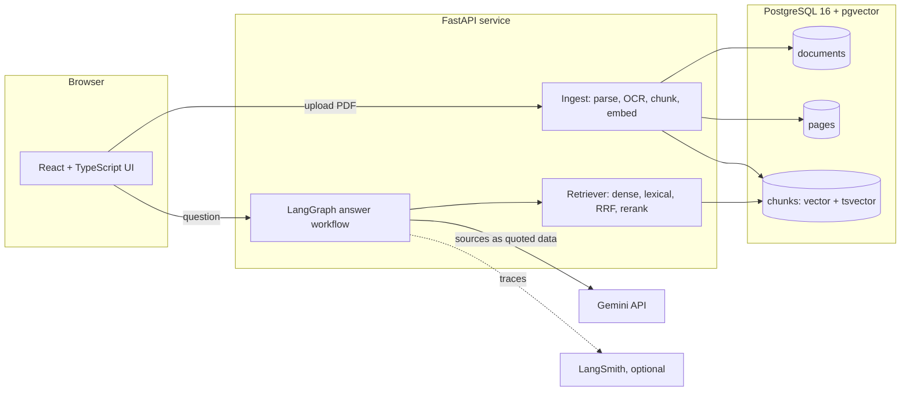

# Architecture

The browser never holds a model key. All model calls go from the API container to Gemini;
only the retrieved chunks for a question leave the machine.

## Ingestion

1. **Page classification** (`ingest/parsing.py`). A page whose raster images cover at least 90%
   of its area is a scan, even if it carries a text layer; legacy OCR layers are discarded.
   A page with fewer than 25 text characters and at least 50% image coverage is also a scan.
2. **Native pages.** pdfplumber tables become Markdown. Remaining words are split into columns
   at whitespace gutters at least 6 pt wide that fewer than 3% of words cross. Lines are grouped
   into headings (larger type, or a bold line that is not a hyphenated wrap) and paragraphs.
   Embedded images covering at least 2% of the page are rendered at 300 dpi and OCR'd as
   `image_text` elements.
3. **Scanned pages** (`ingest/ocr.py`). Deskew by projection-profile search (±3°, 0.1°
   steps). Long horizontal and vertical runs are found on a 1px-dilated dark mask; consecutive
   rules joined by vertical rules form grid candidates. A candidate is accepted as a table only
   if rows are at most 0.6 in tall, mean cell confidence is at least 60 and at least half the
   cells have text; each cell is OCR'd separately. Rejected candidates have their rules erased
   and are read as paragraphs. Single-line paragraphs in type at least 1.25x the page median
   height are headings.
4. **Chunking** (`ingest/chunking.py`). `fixed`: the original 1000/200 character window, with
   page provenance tracked through character offsets. `structure`: one chunk per heading section
   per page, split at 1200 characters; tables and figure text are separate chunks, large tables
   split by rows with the header repeated. Each chunk is prefixed with `title > section` for
   embedding and full-text indexing; the stored `text` is unprefixed for display.
5. **Enrichment.** Chunk metadata: title, section, extraction methods, minimum OCR confidence,
   and injection-pattern flags (`ingest/injection.py`).
6. **Storage.** Re-ingesting a file replaces its rows (document id is a hash of the bytes).

## Retrieval

Query embedding uses bge's query instruction prefix. Dense search is an exact cosine scan
filtered by chunker. Lexical search ORs the query's lexemes against a generated `tsvector`
and ranks with `ts_rank_cd`. Hybrid fuses the two top-20 lists with reciprocal rank fusion
(k = 60). The rerank configuration re-scores the fused top 20 with a MiniLM cross-encoder.

## Answer workflow

See ADR 0004. Sources are passed as labelled, delimited blocks; flagged chunks carry a note
that they contain instruction-like text. The model returns `{answerable, answer, citations}`
through structured output. Citations are labels; code maps them to chunk ids and pages and
drops unknown labels. Refusal reasons: `no_documents`, `low_retrieval_similarity`,
`insufficient_evidence` (after one query rewrite), `no_valid_citation`.

## Trust boundaries

| Boundary | Control | Not controlled |
|---|---|---|
| Uploaded PDF -> parser | size limit, PDF parsing in-process | malicious PDFs targeting pdfium or pdfplumber; no sandbox |
| Document text -> model | delimited sources, system rule, injection flags, no tools | a model that follows embedded text anyway; measured, not prevented |
| Model output -> user | citations validated in code; answer text is rendered as text | factual errors inside a validly cited answer |
| API -> browser | no keys in the bundle | there is no authentication; single-user local deployment only |
