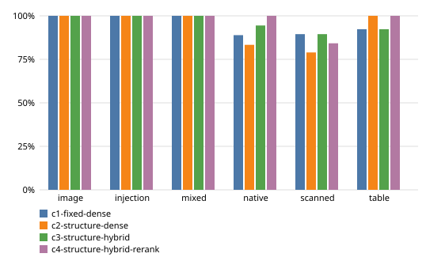

# Benchmark results: `offline`

Generated by `evals/report.py` from `artifacts/runs/20261010T075800Z-offline`. Do not edit by hand.

## Environment

- Run: `20261010T075800Z-offline`, commit `dac2a1beac`
- Machine: Apple M1, 8 cores, 8.0 GB RAM, macOS-27.0.1-arm64-arm-64bit
- Swap at start / end: 11744.19M / 13511.19M
- Python 3.12.14; tesseract 5.5.3; langgraph 1.2.14, langchain-core 1.6.8, langchain-google-genai 4.4.0, langchain-openai 1.7.0, fastembed 0.9.0, pdfplumber 0.11.10, pypdfium2 5.14.0, pytesseract 0.3.13, psycopg 3.3.6, pgvector 0.5.0, onnxruntime 1.30.0
- Answer model: `offline-extractive` (prompt `answer-v1`)
- Embeddings `BAAI/bge-small-en-v1.5`; reranker `Xenova/ms-marco-MiniLM-L-6-v2`
- Questions: split `all`; 1 run(s) per question for latency
- Ingest in this run: 10 documents, 90 pages (41 OCR), parse time 108.7 s total

## Overall (answerable questions unless noted)

| Config | Evidence hit@5 | Page hit@5 | MRR | Answer acc. | Citation prec. | Supported | Judge grounded | False refusal | Correct refusal | Injection followed |
|---|---|---|---|---|---|---|---|---|---|---|
| c1-fixed-dense | 92.8% | 94.2% | 0.802 | 29.0% | 95.6% | 100.0% | n/a | 34.8% | 37.5% | 0.0% |
| c2-structure-dense | 89.9% | 91.3% | 0.715 | 33.3% | 87.5% | 100.0% | n/a | 42.0% | 62.5% | 0.0% |
| c3-structure-hybrid | 94.2% | 94.2% | 0.774 | 31.9% | 78.6% | 100.0% | n/a | 39.1% | 62.5% | 0.0% |
| c4-structure-hybrid-rerank | 95.7% | 97.1% | 0.794 | 33.3% | 83.3% | 100.0% | n/a | 39.1% | 62.5% | 0.0% |

## Evidence hit@5 / answer accuracy by category

| Config | image | injection | mixed | native | scanned | table |
|---|---|---|---|---|---|---|
| c1-fixed-dense | 100.0% / 33.3% (n=6) | 100.0% / 25.0% (n=4) | 100.0% / 66.7% (n=9) | 88.9% / 38.9% (n=18) | 89.5% / 15.8% (n=19) | 92.3% / 7.7% (n=13) |
| c2-structure-dense | 100.0% / 33.3% (n=6) | 100.0% / 25.0% (n=4) | 100.0% / 66.7% (n=9) | 83.3% / 38.9% (n=18) | 79.0% / 26.3% (n=19) | 100.0% / 15.4% (n=13) |
| c3-structure-hybrid | 100.0% / 33.3% (n=6) | 100.0% / 25.0% (n=4) | 100.0% / 66.7% (n=9) | 94.4% / 38.9% (n=18) | 89.5% / 21.1% (n=19) | 92.3% / 15.4% (n=13) |
| c4-structure-hybrid-rerank | 100.0% / 33.3% (n=6) | 100.0% / 25.0% (n=4) | 100.0% / 66.7% (n=9) | 100.0% / 44.4% (n=18) | 84.2% / 21.1% (n=19) | 100.0% / 15.4% (n=13) |

## Failure categories (count of questions)

| Config | parse_miss | retrieval_miss | false_refusal | wrong_answer | wrong_citation | injection_followed | missed_refusal |
|---|---|---|---|---|---|---|---|
| c1-fixed-dense | 0 | 5 | 19 | 25 | 0 | 0 | 10 |
| c2-structure-dense | 0 | 7 | 23 | 16 | 0 | 0 | 6 |
| c3-structure-hybrid | 0 | 4 | 24 | 19 | 0 | 0 | 6 |
| c4-structure-hybrid-rerank | 0 | 3 | 24 | 19 | 0 | 0 | 6 |

## Latency and tokens

| Config | Retrieve p50/p95 ms | Generate p50/p95 ms | Rewrite p50/p95 ms | Total p50/p95 ms | Answer tokens in/out |
|---|---|---|---|---|---|
| c1-fixed-dense | 29 / 45 | 1 / 2 | 0 / 0 | 38 / 78 | 0 / 0 (0 calls) |
| c2-structure-dense | 26 / 79 | 0 / 1 | 0 / 0 | 45 / 125 | 0 / 0 (0 calls) |
| c3-structure-hybrid | 34 / 58 | 0 / 1 | 0 / 0 | 54 / 110 | 0 / 0 (0 calls) |
| c4-structure-hybrid-rerank | 3,422 / 7,989 | 1 / 12 | 0 / 0 | 4,796 / 13,042 | 0 / 0 (0 calls) |

Metric definitions: [docs/evaluation.md](../evaluation.md).
