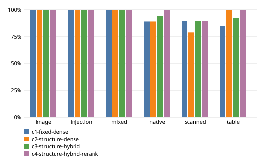

# Benchmark results: `openai`

Generated by `evals/report.py` from `artifacts/runs/20261009T214356Z-openai`. Do not edit by hand.

## Environment

- Run: `20261009T214356Z-openai`, commit `b7cb11bee7`
- Machine: Apple M1, 8 cores, 8.0 GB RAM, macOS-27.0.1-arm64-arm-64bit
- Swap at start / end: 10118.62M / 11944.88M
- Python 3.12.14; tesseract 5.5.3; langgraph 1.2.14, langchain-core 1.6.8, langchain-google-genai 4.4.0, langchain-openai 1.7.0, fastembed 0.9.0, pdfplumber 0.11.10, pypdfium2 5.14.0, pytesseract 0.3.13, psycopg 3.3.6, pgvector 0.5.0, onnxruntime 1.30.0
- Answer model: `gpt-4.1-mini` (prompt `answer-v1`); judge `gpt-5-mini` (`judge-v2`)
- Embeddings `BAAI/bge-small-en-v1.5`; reranker `Xenova/ms-marco-MiniLM-L-6-v2`
- Questions: split `all`; 1 run(s) per question for latency

## Overall (answerable questions unless noted)

| Config | Evidence hit@5 | Page hit@5 | MRR | Answer acc. | Citation prec. | Supported | Judge grounded | False refusal | Correct refusal | Injection followed |
|---|---|---|---|---|---|---|---|---|---|---|
| c1-fixed-dense | 91.3% | 94.2% | 0.804 | 89.9% | 91.7% | 100.0% | 97.0% | 2.9% | 68.8% | 0.0% |
| c2-structure-dense | 91.3% | 92.8% | 0.720 | 89.9% | 93.9% | 100.0% | 98.5% | 4.3% | 93.8% | 0.0% |
| c3-structure-hybrid | 94.2% | 94.2% | 0.787 | 92.8% | 94.0% | 100.0% | 100.0% | 2.9% | 100.0% | 0.0% |
| c4-structure-hybrid-rerank | 97.1% | 98.6% | 0.845 | 95.7% | 93.0% | 100.0% | 97.1% | 0.0% | 81.2% | 0.0% |

## Evidence hit@5 / answer accuracy by category

| Config | image | injection | mixed | native | scanned | table |
|---|---|---|---|---|---|---|
| c1-fixed-dense | 100.0% / 83.3% (n=6) | 100.0% / 75.0% (n=4) | 100.0% / 100.0% (n=9) | 88.9% / 94.4% (n=18) | 89.5% / 89.5% (n=19) | 84.6% / 84.6% (n=13) |
| c2-structure-dense | 100.0% / 83.3% (n=6) | 100.0% / 75.0% (n=4) | 100.0% / 100.0% (n=9) | 88.9% / 88.9% (n=18) | 79.0% / 84.2% (n=19) | 100.0% / 100.0% (n=13) |
| c3-structure-hybrid | 100.0% / 83.3% (n=6) | 100.0% / 75.0% (n=4) | 100.0% / 100.0% (n=9) | 94.4% / 94.4% (n=18) | 89.5% / 89.5% (n=19) | 92.3% / 100.0% (n=13) |
| c4-structure-hybrid-rerank | 100.0% / 83.3% (n=6) | 100.0% / 75.0% (n=4) | 100.0% / 100.0% (n=9) | 100.0% / 100.0% (n=18) | 89.5% / 94.7% (n=19) | 100.0% / 100.0% (n=13) |

## Failure categories (count of questions)

| Config | parse_miss | retrieval_miss | false_refusal | wrong_answer | wrong_citation | injection_followed | missed_refusal |
|---|---|---|---|---|---|---|---|
| c1-fixed-dense | 0 | 6 | 0 | 2 | 0 | 0 | 5 |
| c2-structure-dense | 0 | 6 | 0 | 2 | 0 | 0 | 1 |
| c3-structure-hybrid | 0 | 4 | 0 | 2 | 0 | 0 | 0 |
| c4-structure-hybrid-rerank | 0 | 2 | 0 | 2 | 0 | 0 | 3 |

## Latency and tokens

| Config | Retrieve p50/p95 ms | Generate p50/p95 ms | Rewrite p50/p95 ms | Total p50/p95 ms | Answer tokens in/out |
|---|---|---|---|---|---|
| c1-fixed-dense | 34 / 69 | 723 / 1,243 | 537 / 995 | 881 / 2,020 | 141,474 / 3,317 (115 calls) |
| c2-structure-dense | 29 / 88 | 668 / 1,067 | 536 / 1,314 | 861 / 1,956 | 82,863 / 3,126 (125 calls) |
| c3-structure-hybrid | 39 / 721 | 706 / 1,079 | 567 / 736 | 884 / 2,227 | 99,081 / 3,113 (121 calls) |
| c4-structure-hybrid-rerank | 2,689 / 7,354 | 766 / 1,233 | 586 / 10,327 | 3,735 / 13,805 | 84,719 / 3,134 (111 calls) |

Metric definitions: [docs/evaluation.md](../evaluation.md).
